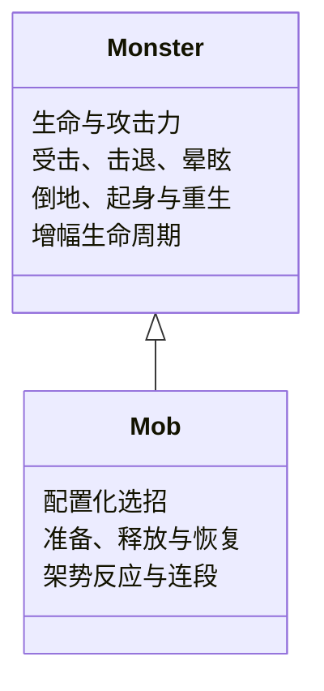

# 怪物与小怪通则

同属一个类别不代表共用同一套战斗风格。每个个体继续拥有自己的选招策略、动画、攻击节奏与专属机制；类别只提供共同接口和基础能力。

本页集中维护继承规则。个体设计稿只写数值差异、独有外形、招法和机制，不重复这些约定。

## 类别与实现

`Monster`是所有怪物的基类，包含小怪、精英、首领与训练对象的共同生命周期。`Mob`继承`Monster`，供普通小怪及精英使用；精英是遭遇等级，不再复制一套小怪控制器。首领和训练对象可以提供自己的选招控制器，但仍走同一套受击与倒地流程。

- 共享实现：`src/monster.js`；共有参数：`src/monster-rules.js`。
- 个体数值与行为配置：`src/monster-catalog.js`；小怪控制器：`src/monster-ai.js`。
- 选招按优先级规则、距离、冷却、概率、加权备选、循环序列配置。控制器不根据敌人标识或外形名称判断机制。
- 需要追击、独立后撤、增幅、架势、受压反攻或恢复中移动时，为对应招式／策略添加能力配置；未配置的能力不生效。

## 通用效果接口

灯笼灵在释放增幅时执行 `battle.applyEffect({type:"damageIncrease",amount:0.2,duration:30,group:"support-damage"})`。默认目标是所有存活的 `Monster`（含普通怪、精英与首领），也可以按类别选择目标。

效果保存在接收者的 `StatusEffects` 中，统一处理刷新、到期和战斗结束清除；共享伤害公式读取接收者的伤害倍率。怪物自己的AI不需要知道场上有没有灯笼，更不需要检查灯笼是否正在施法。远程弹体在发射时记录已经应用效果的攻击力，之后不重复加成。

实现：`src/status-effects.js`、`Monster.applyEffect`、`Battle.applyEffect`、`src/combat-damage.js`。

## 所有怪物共有规则

- 生命伤害采用攻击力×动作倍率，增伤和减伤另外计算；基础破绷不由生命伤害反推。
- 各实例独立拥有状态、计时、骨骼、材质及临时效果。组合中的同类怪不会共用动作状态。
- 默认基础冲击耐受0、可背摔、无永久霸体；例外在个体数值中列出。出招使用招式的出手韧性作为总耐受，结束后恢复基础值，不叠加。
- 受击、击退、晕眩、死亡、被背摔、倒地和起身统一处理。倒地不可受伤，起身可受伤但不被普通冲击打断；起身后立即面向玩家，并有背摔保护时间。具体背摔距离、倒地／起身比例见共享背摔配置。
- 攻击检测具有高度范围。实体间位移需要处理碰撞，不能穿过目标；无敌由独立机制决定，普通位移不自带无敌。
- 同一效果组默认取较强值并刷新时间，是否叠加由效果配置决定；伤害增加只作用于生命伤害；已授予的增幅不因施法者死亡消失，按持续时间清理；战斗结束清除临时效果、状态图标、弹体和反馈。

## 小怪共有规则

- 距离在警戒范围内时选招或接近；自由移动按各自转向速度平滑转向。
- 招式经历准备、释放、恢复三个阶段。普通小怪默认在释放进度70%结算一次，默认出手前0.18秒锁定方向；架势不产生攻击命中，位移不产生伤害。
- 出招被有效冲击打断后取消未释放的后续部分，释放前被打断不授予效果。具有恢复锁定能力的招式，即使受击也不提前解除原本冷却；未配置该能力则不继承它。
- 连段、半血续招、恢复中移动、概率后撤等均由能力配置决定，不是所有小怪的默认能力。
- 近战结算接触；远程释放时生成实体弹体，连续扫掠并检查高度。按配置的基础提前量、距离及玩家近期位移预判瞄准；弹体按发射时攻击力结算，飞行中不追踪，不因施法者死亡消失，战斗结束清除。
- 弹体可格挡与闪避，完美格挡给金光，但不隔空震退远处施法者。格挡档位、金光、冲击与玩家受击规则统一复用战斗系统。

## 招式类别与不适用值

`EnemyMove`为基础招式；`AttackMove`、`ProjectileMove`、`StanceMove`、`BuffMove`、`MovementMove`分别描述近战、远程、架势、增幅、位移。代码见 `src/enemy-move.js`。

| 类别 | 专属参数 | 不具有的参数 |
| --- | --- | --- |
| 近战 | 动作倍率、破绷、攻击体积、冲击力、突进 | 弹体参数 |
| 远程 | 攻击属性、弹速、射程、数量、散角、发射高度 | 架势与增幅参数 |
| 架势 | 检测距离、判定扇区、可弹冲击上限、反应窗口、成功反馈、回斩衔接 | 生命伤害、动作倍率、破绷、冲击力 |
| 增幅 | 增幅比例、持续时间、目标范围与刷新规则 | 生命伤害、动作倍率、破绷、冲击力、攻击体积 |
| 位移 | 位移距离与动作时长 | 生命伤害、动作倍率、破绷、冲击力、攻击体积 |

不适用的数值统一查询为`-1`，不是零伤害攻击；这些值不参加伤害结算，也不显示为可调伤害参数。个体文档按类别分表，不在架势／增幅／位移表中塞入“默认生命伤害”等无效列。默认生命伤害只展示攻击力×动作倍率的基础结果。

## 建模与绑定

以下为所有建模交付共有约定。每份个体文档保留150字以内的独立提示词及个体比例，详细交付要求不再重复。

- 未上色单体角色，无场景、文字、地台、光效和多视角拼图；不烘焙颜色、光照与阴影，保留材质区和UV，后续统一上色。
- Blender按米建模，Z朝上、面朝-Y，应用旋转与缩放。足底中央为原点，悬浮单位以主体底部中央为原点。
- 人形使用对称A姿势、张掌；多足单位对称自然站立。武器与道具独立，不与手或身体焊接。L/R均以角色自身为准。
- 关节保留3～5圈干净环线，指节至少三圈；腋窝、指间、腿间不粘连。硬甲分件、关节留隙；避免杂面、重复点、零面积面与反法线。
- 按部位命名，交付可编辑源文件及GLB。普通怪约1万～2万三角面、精英1.5万～3万、首领2万～4万，以轮廓与关节质量为先。

灯笼灵是非人形背摔资格的明确例外：允许背摔。螳螂、刺壳虫、弩尾蜥仍不可背摔。

## 招式后的自由调整

所有小怪（含精英）完整招式或内部连段收招后，额外至少0.5秒不出新招，可以转向、侧移和接近玩家。独立于招式后摇，期间压力反击也不能跳过该窗口；连段内部已设计的连击间隔保留。统一配置MOB_RULES.freeMovementMin，武士首领和训练人偶沿用自己的控制器。

敌人攻击预警在命中、发射或范围技能开始生效前 1 秒出现。预警在生效前 0.35 至 0.2 秒闪烁一次，约在前 0.275 秒达到最高亮度。原先出手更快的招式会延长准备时间。镜盾侍的弹反回斩直接出手。

双敌战斗只有当前仇恨目标可以主动追击。其他敌人在招式够得着玩家时照常攻击。非仇恨目标的远程出手距离上限是 4 米，发射前会重新检查距离。
